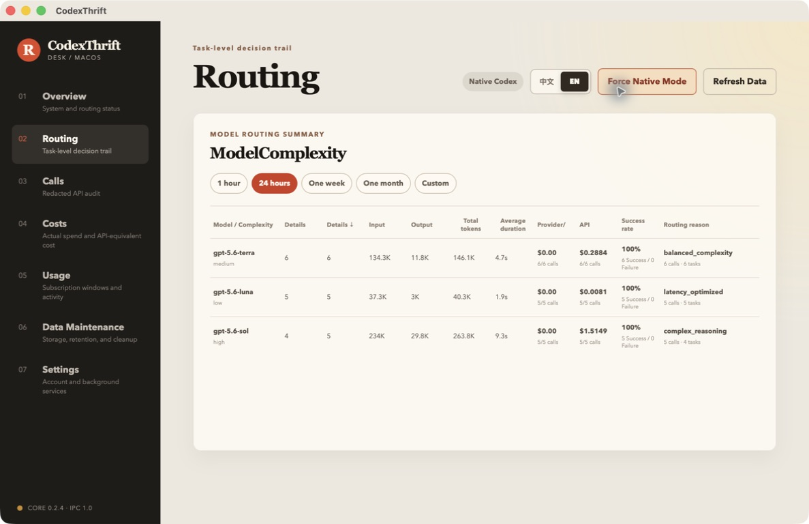
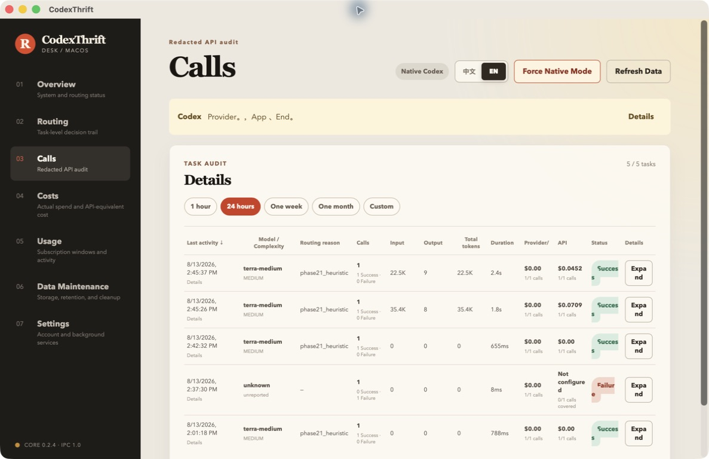
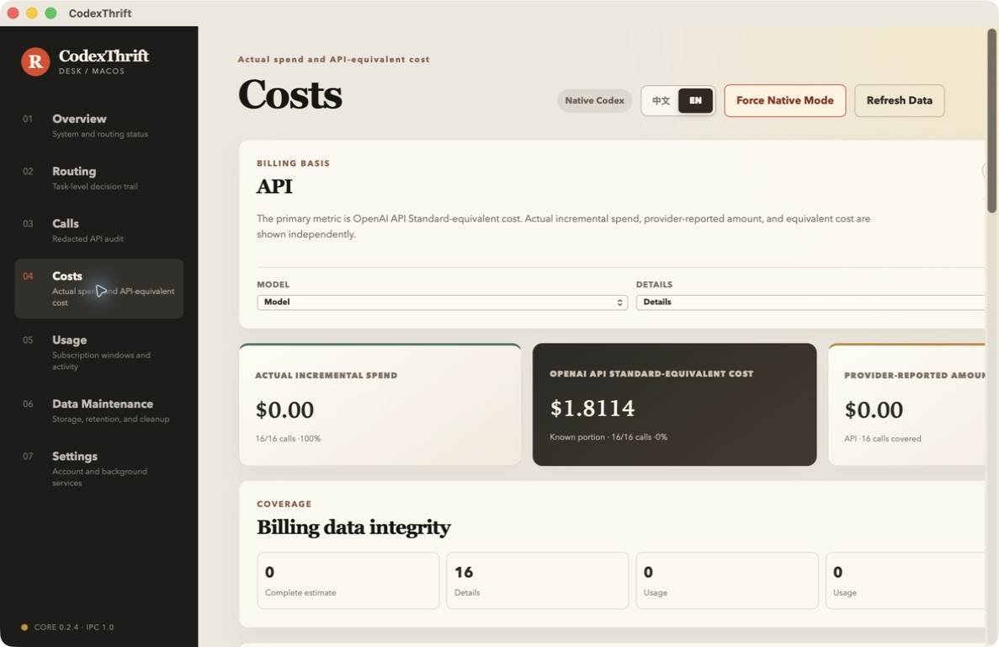
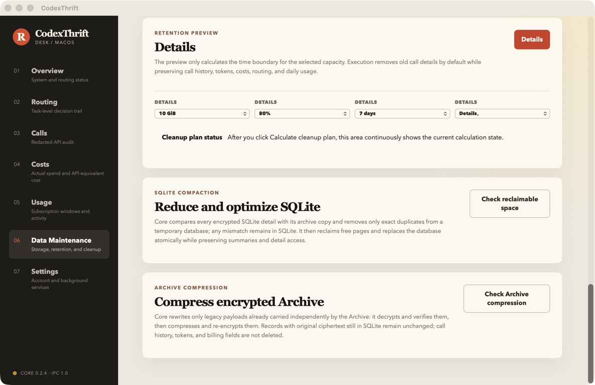

# CodexThrift

[简体中文](README.zh-CN.md)

**Spend fewer Codex credits—without blindly downgrading every task.**

CodexThrift is a local-first macOS control center and open routing core for Codex. It routes work across Luna, Terra, and Sol, explains each task-level decision, shows where tokens and API-equivalent cost go, keeps subscription usage visible, and lets you return to native Codex in one click.

[Download for macOS](https://github.com/felixzhou2005/codexthrift-core/releases/download/macos-v0.2.0/CodexThrift_0.2.0_universal.dmg) · [macOS release notes](https://github.com/felixzhou2005/codexthrift-core/releases/tag/macos-v0.2.0) · [Open-source Core](https://github.com/felixzhou2005/codexthrift-core/releases/tag/core-v0.2.4)

    

> CodexThrift is an independent project and is not affiliated with or endorsed by OpenAI. Codex, ChatGPT, and model names belong to their respective owners.

## Why CodexThrift exists

In a growing agentic coding session, the expensive part is often not the final answer. It is the repeated input: repository context, tool results, instructions, and an increasingly mixed conversation history sent again on later calls.

That creates three practical problems:

- It is hard to know whether a task really needs the most capable model.
- Long sessions repeatedly carry old context, including unrelated projects or tasks.
- Running LiteLLM locally still requires configuration, OAuth, proxy lifecycle management, recovery, and careful switching back to native Codex.

CodexThrift turns those concerns into a normal macOS workflow and gives you the data needed to improve it.



## Download the macOS app

- **CodexThrift App:** `0.2.0`
- **Bundled Core:** `0.2.4`
- **System:** macOS 13 or later
- **Architecture:** Universal—Apple Silicon (`arm64`) and Intel (`x86_64`)
- **Distribution:** Developer ID signed and Apple notarized
- **Updates:** manual download for this release; automatic updates are not enabled yet

### Install

1. [Download the Universal DMG](https://github.com/felixzhou2005/codexthrift-core/releases/download/macos-v0.2.0/CodexThrift_0.2.0_universal.dmg).
2. Open the DMG and drag **CodexThrift** into **Applications**.
3. Launch CodexThrift and follow the macOS prompt if background-service approval is required.
4. Connect your existing Codex/ChatGPT account.
5. Keep native Codex or enable smart routing when you want model and cost optimization.

The app does not include an OpenAI subscription. You need an account with access to the Codex capabilities you intend to use.

## What the app does

### Smart routing with a native safety net

- Route suitable work across Luna, Terra, and Sol with configurable reasoning effort.
- Validate the proxy and a real Responses request before making smart routing active.
- Keep native and routed session history visible and resumable through their original providers.
- Switch back to native OpenAI in one click, even when the proxy is unhealthy.
- Guide CLI, VS Code, and desktop users through the reload required for already-running clients.

Native Codex remains the recovery path. Smart routing is an optimization layer, not a lock-in mechanism.

### Task-level routing analytics

CodexThrift groups related continuations into logical tasks instead of treating every tool call as unrelated. The Routing page shows the selected model and reasoning effort, routing reason, input and output tokens, latency, success rate, and Standard API-equivalent cost.

This makes model-selection mistakes visible and gives you evidence for improving routing policies.

### Redacted call audit



Inspect logical tasks and individual calls without turning the dashboard into another raw log viewer:

- model, reasoning effort, token counts, duration, outcome, and error state;
- task-to-call continuation relationships;
- filters and detailed drill-down views;
- local redaction and encrypted storage for sensitive payload data;
- explicit confirmation before protected raw detail is read.

### Cost analysis without mixing billing concepts



The Costs page keeps three different numbers separate:

1. **Actual incremental spend** recorded for the account.
2. **Provider-reported amount** when a provider supplies one.
3. **Standard API-equivalent cost** calculated from model pricing and observed tokens.

API-equivalent cost is an analytical comparison—not a claim about what OpenAI billed for a Codex subscription.

### Subscription usage and reset windows

The Usage page presents account state, subscription windows, usage activity, remaining percentage, and reset timing. Sections load independently, so one slow or unavailable source does not block the rest of the dashboard. Native calls do not receive invented routing, token, or cost data when those measurements do not exist.

### Safe storage maintenance



CodexThrift keeps operational history useful without allowing local storage to grow forever:

- preview retention candidates before deleting details;
- protect shared references and billing records;
- rebuild and physically reduce SQLite with `VACUUM INTO`;
- compress eligible archive payloads before encryption;
- verify temporary copies, record counts, integrity, and recovery canaries;
- replace databases and archives atomically, with cancellation before irreversible stages.

Maintenance jobs distinguish “completed” from “space was actually reclaimed” and attempt to preserve the original data when verification fails.

### macOS background service

The app manages Core through the macOS background-service workflow. It reports registration and approval state, restores the desired proxy state after login, keeps the service running when the window closes, and blocks unsafe removal while Codex is still using the proxy.

## What the data is teaching us

Early observations from the developer's own call history suggest several useful optimization patterns:

- **Input tokens dominate many long sessions.** Repeated conversation history and tool output can cost more than the final answer.
- **Mixed-topic sessions are wasteful.** Combining unrelated projects or tasks increases repeated input and can reduce focus.
- **Sol can plan; Luna can execute.** A strong model can produce the difficult plan while Luna handles well-specified execution steps at much lower equivalent cost.
- **Compact earlier, not only when forced.** Removing stale detail from long contexts reduces what later calls must reread.

These are observations, not guaranteed savings for every workload. CodexThrift exposes detailed call data so users can test the patterns on their own work.

Planned research includes relevance-aware session cleanup: identifying historical content unrelated to the current request before it is sent again, with conservative review and rollback controls.

## Open Core, commercial product experience

| Layer | Availability | Responsibility |
| --- | --- | --- |
| CodexThrift Core | MIT-licensed source in this repository | OAuth and configuration writes, proxy lifecycle, routing, quota, audit, cost data, storage maintenance, CLI/MCP/daemon, and versioned IPC |
| CodexThrift for macOS | Downloadable commercial app; source is private | React/Tauri interface, onboarding, macOS background service, Core artifact verification, signing, notarization, installation, and product experience |

The macOS application source and binary are not licensed under this repository's MIT license. Native clients consume only formally released Core artifacts and the public versioned IPC contract.

See [Repository Boundary](docs/REPOSITORY_BOUNDARY.md) and [Architecture](docs/ARCHITECTURE.md).

## Local-first boundaries

- Runtime state, credentials, call history, and protected payloads remain on the Mac.
- Core uses a local Unix Domain Socket and versioned JSON-RPC contract.
- The repository excludes user data, credentials, signing material, databases, logs, and private App source.
- Screenshots in this README use controlled release-validation data.

## Use the open-source Core

The public source history begins at `0.2.0`. It includes the supported Core source, tests, IPC schemas, packaging, SBOM/release tooling, and verified macOS Runtime artifacts.

```bash
uv sync --extra dev --extra runtime
uv run pytest -p no:cacheprovider
uv run codexthrift --help
uv run codexthriftd --self-test
```

The main entry points are `doctor`, `init`, `start`, `run`, `dashboard`, `mcp`, and `stop`. Run `uv lock --check` before submitting a dependency change. Read [Core Release Process](docs/RELEASE.md) before creating a tag or public release.

## Security and license

Report vulnerabilities privately through GitHub's security reporting workflow; do not open a public issue containing credentials or exploit details.

Core source files are licensed under the [MIT License](LICENSE). See [NOTICE](NOTICE) and [THIRD_PARTY_NOTICES.md](THIRD_PARTY_NOTICES.md) for attribution. The macOS App is distributed separately and is outside the Core MIT license.
