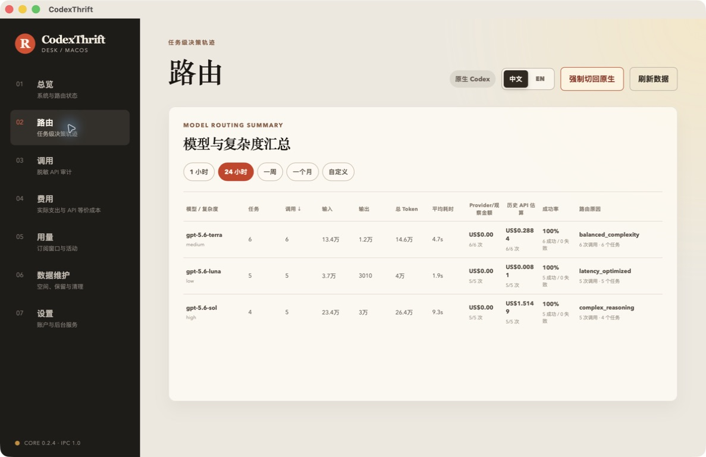
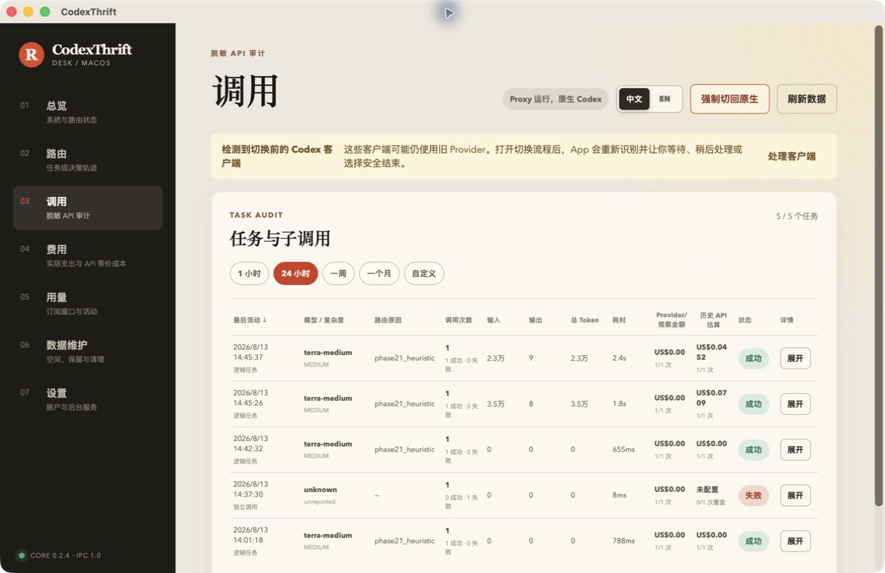
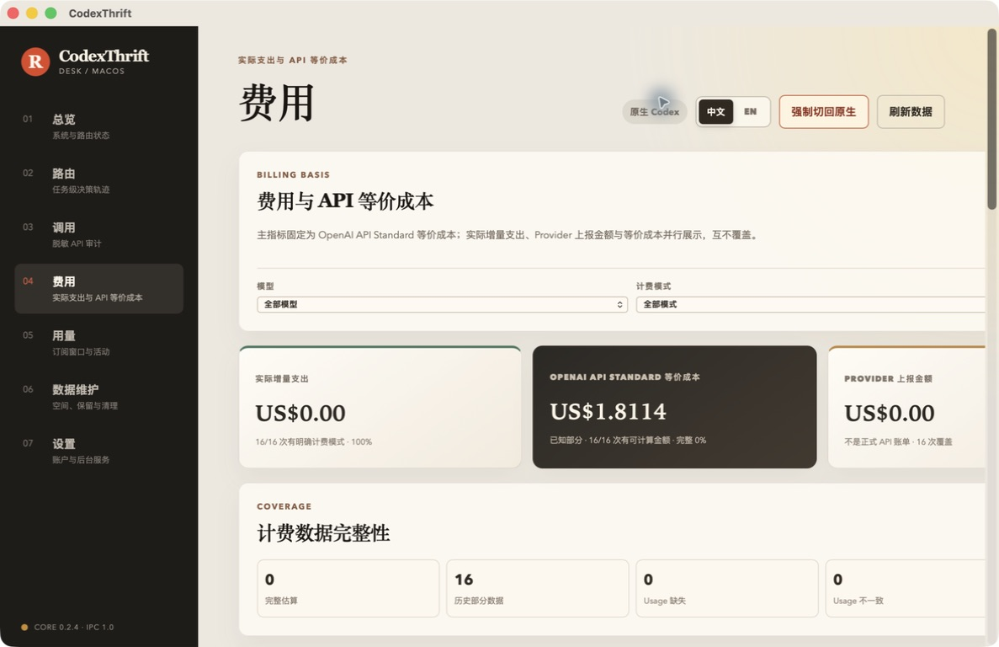
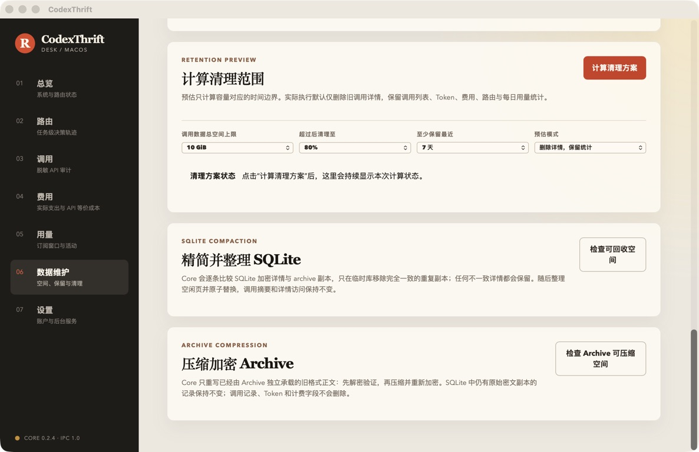

# CodexThrift

[English](README.md)

**减少 Codex 消耗，但不以牺牲复杂任务的质量为代价。**

CodexThrift 是一个本地优先的 Codex macOS 控制中心和开源路由核心：它可以在 Luna、Terra 和 Sol 之间智能选择模型，解释每个任务的路由决策，分析 Token 与 API 等价成本，展示订阅额度，并在任何时候一键安全切回原生 Codex。

[下载 macOS App](https://github.com/felixzhou2005/codexthrift-core/releases/download/macos-v0.2.0/CodexThrift_0.2.0_universal.dmg) · [macOS 版本说明](https://github.com/felixzhou2005/codexthrift-core/releases/tag/macos-v0.2.0) · [开源 Core](https://github.com/felixzhou2005/codexthrift-core/releases/tag/core-v0.2.4)

    

> CodexThrift 是独立项目，与 OpenAI 没有关联，也未获得 OpenAI 官方背书。Codex、ChatGPT 和模型名称属于其各自权利人。

## 为什么要做 CodexThrift

当一个智能编程 Session 越来越长，昂贵的部分往往不是最后输出的答案，而是每次调用都会重复发送的输入：仓库上下文、工具结果、系统指令，以及不断增长、甚至混入不同项目的对话历史。

这会带来三个实际问题：

- 很难判断一个任务是否真的需要最强模型。
- 长 Session 会反复携带旧上下文，包括已经无关的项目或任务。
- LiteLLM 很强，但本地配置、OAuth、Proxy 生命周期、异常恢复，以及安全切回原生 Codex，仍然需要大量工程工作。

CodexThrift 把这些能力变成普通 macOS 用户可以直接使用的产品流程，同时提供持续优化所需的数据。



## 下载 macOS App

- **CodexThrift App：** `0.2.0`
- **内置 Core：** `0.2.4`
- **系统要求：** macOS 13 或更高版本
- **架构：** Universal，同时支持 Apple Silicon（`arm64`）和 Intel（`x86_64`）
- **分发方式：** Developer ID 签名并通过 Apple 公证
- **版本更新：** 当前版本需要手动下载更新，自动更新尚未启用

### 安装方法

1. [下载 Universal DMG](https://github.com/felixzhou2005/codexthrift-core/releases/download/macos-v0.2.0/CodexThrift_0.2.0_universal.dmg)。
2. 打开 DMG，将 **CodexThrift** 拖入 **Applications/应用程序**。
3. 启动 CodexThrift；如果 macOS 要求批准后台服务，请按照 App 提示操作。
4. 连接你已有的 Codex/ChatGPT 账户。
5. 保持使用原生 Codex，或在需要模型和成本优化时启用智能路由。

App 不包含 OpenAI 订阅；你需要已有可使用相应 Codex 能力的账户。

## App 能做什么

### 智能路由，同时保留原生安全网

- 根据任务在 Luna、Terra 和 Sol 之间进行路由，并配置合适的 reasoning effort。
- 启用智能路由前，验证 Proxy 以及真实的 Responses 请求链路。
- Native 与 routed Session 历史继续可见，并通过各自原 Provider 恢复。
- 即使 Proxy 异常，也能一键切回原生 OpenAI。
- 为 CLI、VS Code 和桌面客户端提供明确的重载步骤，避免已运行客户端继续使用旧配置。

原生 Codex 始终是可靠的恢复路径；智能路由是优化层，而不是锁定用户的机制。

### 任务级路由分析

CodexThrift 会把连续工具调用整理为逻辑任务，而不是把每个调用都当成互不相关的请求。路由页面展示模型与 reasoning effort、路由原因、输入与输出 Token、延迟、成功率和 Standard API 等价成本。

这样可以真正发现模型选择错误，并基于数据改进路由策略。

### 脱敏调用审计



在不把 Dashboard 变成原始日志浏览器的前提下，检查逻辑任务和单次调用：

- 模型、reasoning effort、Token、耗时、结果和错误状态；
- 任务与后续工具调用之间的连续关系；
- 过滤、排序与详情下钻；
- 对敏感 Payload 进行本地脱敏和加密存储；
- 读取受保护原始详情前要求明确确认。

### 不混淆不同口径的成本分析



费用页面严格区分三种数字：

1. **实际增量支出**：账户真实记录到的额外支出。
2. **Provider 上报金额**：Provider 明确返回的金额。
3. **Standard API 等价成本**：根据模型价格和观测到的 Token 计算出的等价金额。

API 等价成本是分析和对比指标，不代表 OpenAI 对 Codex 订阅用户的实际账单。

### 订阅额度与重置窗口

用量页面展示账户状态、订阅窗口、近期活动、剩余比例和重置时间。不同区域独立加载，一个较慢或暂时不可用的数据源不会阻塞整个 Dashboard。对于不存在路由、Token 或成本遥测的 Native 调用，系统不会伪造数据。

### 安全的数据整理与压缩



在保留分析价值的同时，避免本地存储无限增长：

- 删除详情前先预览保留候选；
- 保护共享引用和计费记录；
- 使用 `VACUUM INTO` 安全重建并实际缩小 SQLite；
- 在加密前压缩符合条件的 Archive Payload；
- 校验临时副本、记录数、数据库完整性和详情恢复抽样；
- 原子替换数据库和 Archive，并允许在不可逆阶段前取消。

维护任务会区分“任务完成”和“磁盘空间已真实回收”；验证失败时会尽力保留原始数据。

### macOS 后台服务

App 通过 macOS 后台服务机制管理 Core，展示注册和系统批准状态，在登录后恢复期望的 Proxy 状态，窗口关闭后继续运行，并在 Codex 仍使用 Proxy 时阻止不安全的服务注销。

## 调用数据带给我们的发现

开发者自己的调用历史初步显示了几个值得继续验证的优化模式：

- **长 Session 的主要成本经常来自输入 Token。** 重复对话历史和工具输出可能比最终答案更昂贵。
- **混合主题的 Session 很浪费。** 在一个 Session 中同时处理不同项目或无关任务，会增加重复输入，也可能降低任务聚焦度。
- **让 Sol 规划，让 Luna 执行。** 强模型负责制定复杂方案，Luna 负责执行已经清晰定义的步骤，可以显著降低 API 等价成本。
- **应该更早 Compact，而不是等到不得不做。** 及时清除长上下文中的过期细节，可以减少后续调用需要重复读取的内容。

这些是观察结果，不保证适用于每一种工作负载。CodexThrift 提供详细调用数据，让每个用户都能用自己的项目进行分析和验证。

后续研究方向包括“基于相关性的 Session 清理”：在历史内容再次进入请求前，识别与当前问题无关的部分，并提供保守的审查和回滚机制。

## 核心开源，产品体验商业化

| 层级 | 开放方式 | 主要职责 |
| --- | --- | --- |
| CodexThrift Core | 本仓库中的 MIT 开源代码 | OAuth 与配置写入、Proxy 生命周期、智能路由、额度、调用审计、成本数据、存储维护、CLI/MCP/Daemon 和版本化 IPC |
| CodexThrift macOS App | 可下载的商业 App，源码私有 | React/Tauri 界面、上手流程、macOS 后台服务、Core 产物验证、签名、公证、安装与完整产品体验 |

macOS App 的源码和二进制不属于本仓库的 MIT 许可范围。原生客户端只使用正式发布的 Core 产物以及公开、版本化的 IPC 协议。

详细边界请参阅[仓库边界](docs/REPOSITORY_BOUNDARY.md)和[系统架构](docs/ARCHITECTURE.md)。

## 本地优先的边界

- 运行状态、凭据、调用历史和受保护 Payload 保留在用户 Mac 上。
- Core 使用本地 Unix Domain Socket 和版本化 JSON-RPC 协议。
- 公开仓库排除用户数据、凭据、签名材料、数据库、日志和私有 App 源码。
- README 截图使用受控的发布验证数据。

## 使用开源 Core

公开源码历史从 `0.2.0` 开始，包含受支持的 Core 源码、测试、IPC Schema、打包工具、SBOM/发布流程和经过验证的 macOS Runtime 产物。

```bash
uv sync --extra dev --extra runtime
uv run pytest -p no:cacheprovider
uv run codexthrift --help
uv run codexthriftd --self-test
```

主要命令包括 `doctor`、`init`、`start`、`run`、`dashboard`、`mcp` 和 `stop`。提交依赖变更前运行 `uv lock --check`。创建 tag 或公开发布前阅读 [Core 发布流程](docs/RELEASE.md)。

## 安全与许可证

请通过 GitHub 的私密安全报告流程提交漏洞，不要在公开 Issue 中粘贴凭据或漏洞利用细节。

Core 源文件使用 [MIT License](LICENSE)。第三方归属信息参阅 [NOTICE](NOTICE) 和 [THIRD_PARTY_NOTICES.md](THIRD_PARTY_NOTICES.md)。macOS App 独立分发，不属于 Core 的 MIT 许可范围。
